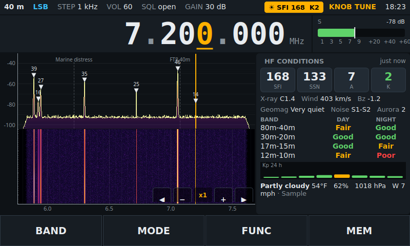
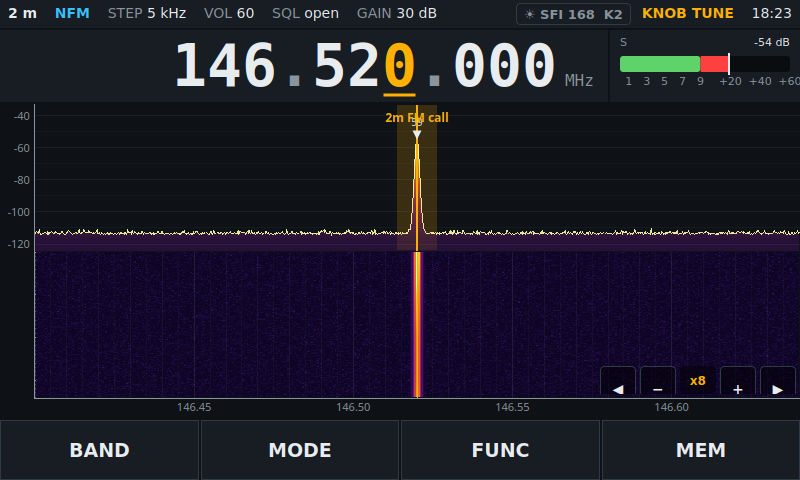
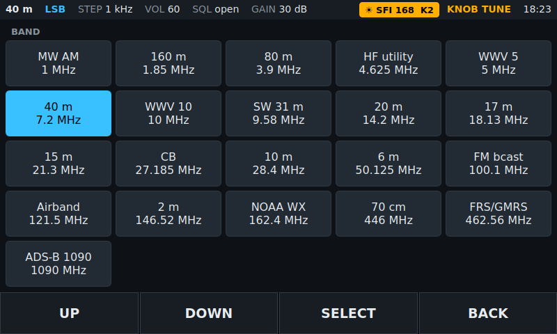
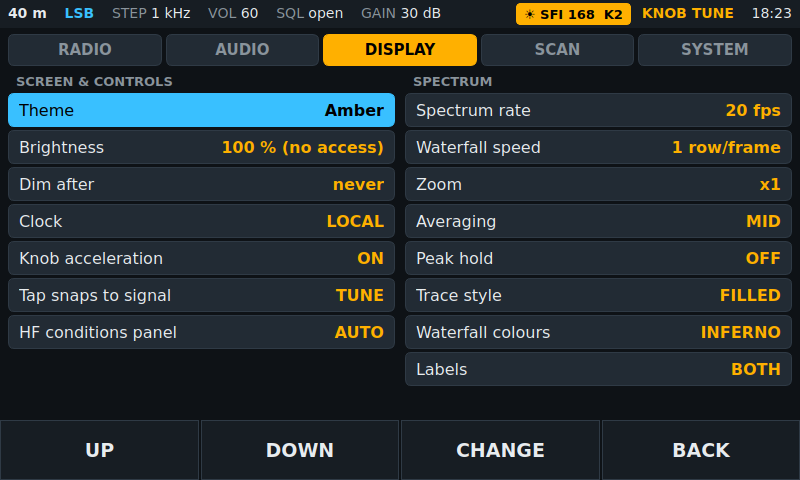
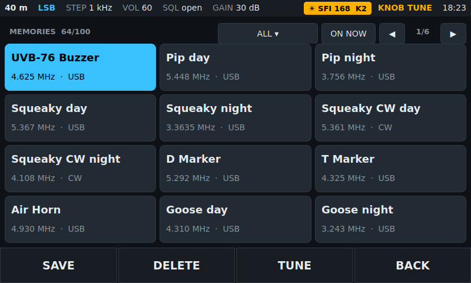
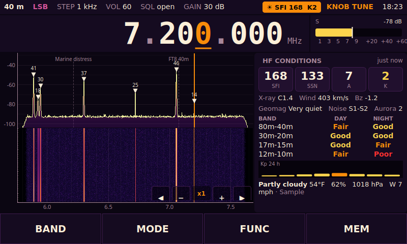
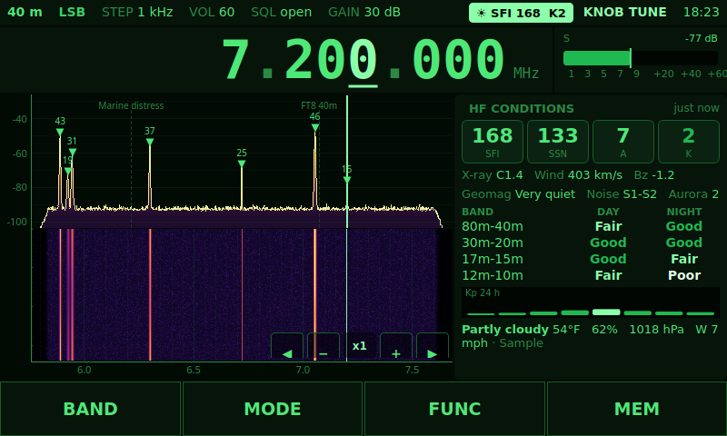
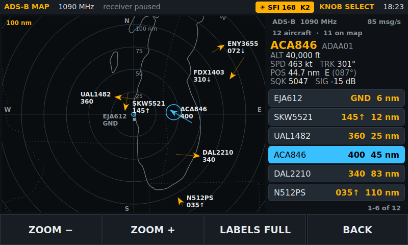

# PiSDR - a touch-first receiver built from a Raspberry Pi 4 and an RTL-SDR Blog V4

A self-contained SDR receiver: Raspberry Pi 4, RTL-SDR Blog V4, Hosyond 7" 800x480 DSI
touchscreen, one EC11 rotary encoder module and four 12 mm tactile keys, in a 3D-printed
enclosure. The receiver application is written for this exact screen and control set
(GNU Radio backend, PyQt/pyqtgraph front end), so the knob and keys do what a radio
owner expects rather than driving a desktop program through a remote-control socket.

## What is in this repository

| Path | Contents |
|---|---|
| `docs/01_hardware.md` | Bill of materials, verified dimensions, wiring and GPIO map, power budget, RFI notes |
| `docs/02_software_setup.md` | Raspberry Pi OS setup, RTL-SDR V4 driver verification, installing and auto-starting the app |
| `docs/03_enclosure.md` | Dimensioned spec sheet for the enclosure and the **fit sheet** to fill in before printing |
| `docs/04_assembly_and_test.md` | Bench test -> test coupon -> full print -> assembly -> thermal/reception test |
| `docs/05_backlog.md` | What has been added and what is next (multi-band with a second tuner, hardware add-ons) |
| `software/pisdr/` | The receiver application (`python3 -m pisdr`) |
| `software/config/bands.json` | Editable band / preset table |
| `software/config/outlines.npz` | Coastlines, lakes and borders for the ADS-B map (Natural Earth, public domain; rebuilt by `software/tools/build_outlines.py`) |
| `software/tests/` | Test suite (`python -m pytest`); runs on a PC with no radio or display |
| `software/tools/screenshots.py` | Renders the screenshots in `docs/images/` from the simulator |
| `cad/` | Parametric OpenSCAD sources for every printed part plus `export.ps1` to render STLs |
| `Original/` | The first-pass ChatGPT design, kept unchanged for reference |

## Why the original design was replaced

The `Original/` folder describes a 208 x 188 x 78 mm box. None of those numbers came from
the parts actually in hand:

- The Hosyond B0D3QB7X4Z module measures **164.89 x 102.00 x 12.25 mm** with an active
  area of **154.68 x 87.02 mm** (manufacturer manual). A 188 mm tall faceplate for a
  102 mm tall screen is why the window and holes never lined up.
- The Pi 4 is designed to bolt to the back of that display on the supplied M2.5 standoffs
  and to be powered through pogo pins. The display plus Pi is one rigid ~35 mm stack and
  the enclosure has to be designed around that stack, not around a loose Pi.
- The software plan was a leftover from an HF-only upconverter design: tuning clamped to
  0.5-30 MHz (the V4 covers 500 kHz to 1.7 GHz on its own), a new TCP connection to Gqrx
  for every encoder click, and an encoder push that merely duplicated the STEP key.

This version is **measure-first**: every dimension that depends on your physical parts is a
single variable in `cad/pisdr_params.scad` marked `// MEASURE`, and
`docs/03_enclosure.md` contains the list of measurements to take with calipers before
the first full print.

## Bill of materials (summary)

Full table with notes in `docs/01_hardware.md`.

- Raspberry Pi 4 Model B (2 GB or more), 5.1 V / 3 A USB-C supply, microSD 16 GB+
- RTL-SDR Blog V4 (R828D, 1 ppm TCXO, SMA) and a 15-30 cm USB-A male-to-female extension
- Hosyond 7" IPS capacitive DSI touchscreen, 800x480 (B0D3QB7X4Z) with its standoffs and FFC
- EC11 rotary encoder **module** (5 pins: GND, +, SW, DT, CLK)
- 4 x 12 x 12 x 7.3 mm tactile switches, small piece of perfboard, hook-up wire, Dupont connectors
- SMA female-female bulkhead adapter and a short SMA male-male pigtail
- Panel-mount USB-C extension (power) and panel-mount 3.5 mm extension (audio)
- 4 x M3 heat-set inserts and M3 x 10 countersunk screws; 2 x M2.5 x 12 screws for the key board
- Optional: copper or aluminium foil tape for an RF lining, a small 5 V fan, powered speaker or headphones


Screenshots are rendered from the simulated backend by `software/tools/screenshots.py`; the
HF conditions numbers and the aircraft in them are sample values.

| | |
|---|---|
|  |  |
|  |  |
|  |  |
|  |  |

## Controls at a glance

```text
+------------------------------------------------------------+---------+
|                                                            |         |
|   800 x 480 touchscreen                                    |  (( ))  |  <- EC11 knob
|   spectrum + waterfall, tap a signal to tune it            |  TUNE   |
|   big frequency readout, tap a digit to pick the step      |         |
|                                                            |  RTL-SDR|
|  [ BAND  ] [ MODE  ] [ FUNC  ] [ REC   ]  <- soft-key bar  |   V4    |
+------------------------------------------------------------+         |
|     [K1]       [K2]       [K3]       [K4]   <- 4 tactile keys        |
+----------------------------------------------------------------------+
```

- The four keys sit directly below the screen; the bar along the bottom of the screen
  labels them, so their meaning can change with context.
- Default page: `BAND / MODE / FUNC / MEM`. `FUNC` cycles what the knob controls
  (TUNE -> VOLUME -> SQUELCH -> GAIN, returning to TUNE after a few seconds idle).
- `MEM` opens saved frequencies (filter by group or "ON NOW" schedule); long-press `MEM`
  starts a band (or memory) scan. While scanning the keys become `HOLD / SKIP / BAND|MEM / STOP`;
  long-press `SKIP` locks the channel out. A priority channel can be checked while scanning,
  and every hold goes into a scan log.
- In `CW` mode a Morse decoder strip shows decoded text and the sender's WPM. On FM
  broadcast an RDS strip shows the station name and radio text (with `gr-rds`), and a
  `multimon-ng` strip decodes APRS, POCSAG, FLEX, EAS or DTMF.
- The spectrum marks detected signals with their level, labels known frequencies (memories,
  FM names learned from RDS, a built-in list), zooms to ×64 and has `◀ − + ▶` buttons to
  zoom and seek signal to signal. A tap near a signal snaps to it.
- Below 30 MHz an **HF conditions** panel (SFI/SSN/A/K, band conditions, 24 h Kp, local
  weather) sits beside the spectrum; the `☀ SFI K` chip in the top bar toggles it.
- Picking the **ADS-B 1090** band opens an **aircraft map**: a radar-style plot with range
  rings, coastlines, callsigns, flight levels and trails, and a list of the nearest
  aircraft. The keys become `ZOOM − / ZOOM + / LABELS / BACK`, the knob selects an aircraft.
  The dongle is lent to `dump1090` while the map is open (see `docs/02_software_setup.md`
  section 5f).
- Encoder push cycles the tuning step (10 Hz ... 1 MHz). Long-press `FUNC` opens Settings,
  in five tabs: RADIO (filter widths, PPM, S-meter cal, CW pitch, decoders), AUDIO (DSP,
  recordings browser, record timer), DISPLAY (themes, brightness/dimming, UTC clock, knob
  acceleration, spectrum zoom/averaging/peak hold/style/colours/labels), SCAN (timing, priority, lockouts, log)
  and SYSTEM (presets, rtl_tcp network mode, ADS-B map, shutdown).

## Build order

1. Read `docs/01_hardware.md` and `docs/02_software_setup.md`; get the Pi, screen and V4
   working on the bench with the application running (no enclosure yet).
2. Wire the encoder and keys, confirm every control in the app.
3. Fill in the fit sheet in `docs/03_enclosure.md`, update `cad/pisdr_params.scad`,
   print the test coupon, then the full enclosure.
4. Assemble and run the thermal / reception test in `docs/04_assembly_and_test.md`.

## Developing on a PC

The UI runs on Windows, macOS or Linux without any radio hardware using a simulated
backend:

```powershell
cd software
python -m pip install -r requirements-dev.txt   # numpy, pyqtgraph, PyQt5 (PyQt6 also works), pytest
python -m pisdr --sim --windowed
```

On the Pi the real GNU Radio backend is selected automatically when `gnuradio` is
importable and an RTL-SDR is attached.

### Tests

```powershell
cd software
python -m pytest
```

About 380 tests in about a minute, with no radio, display or network. They cover the
settings and memory files (including damaged ones), tuning, scanning, the record timer,
signal detection, the Morse decoder, the ADS-B map, and every page of the UI including a few
thousand random key presses, knob turns and taps. The real flowgraph code in
`pisdr/radio/flowgraph.py` is exercised against a stand-in for GNU Radio
(`tests/fakegr.py`) that records which blocks are connected to which; this checks the
wiring and the order of operations, not the signal processing. The ADS-B tests use a shell
script in place of `dump1090`; if a real one is installed (or `PISDR_TEST_DUMP1090` names
one) a further test feeds it a synthetic recording and checks the decoded positions.
Nothing here replaces trying a change on the Pi with the dongle attached:
`python3 -m pisdr --check` there.

### Screenshots

```powershell
cd software
python tools/screenshots.py              # rewrites ../docs/images/ui_*.png
python tools/screenshots.py C:\temp\shots # or writes them somewhere else
```

It runs without a window and with a throw-away settings folder, so it does not touch your
own settings or memories. It is also the quickest way to look at a UI change at 800x480.
