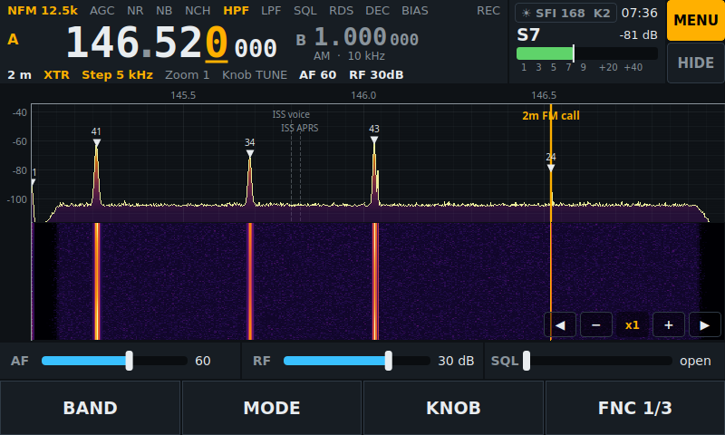
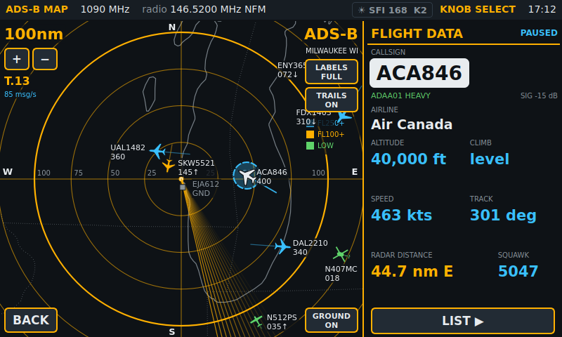
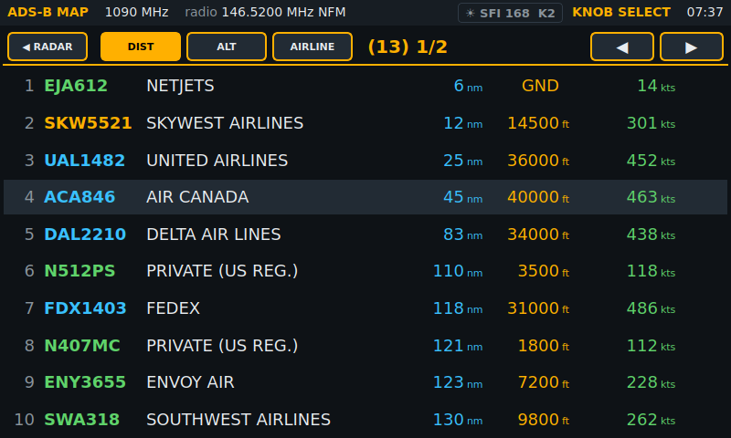

# 02 - Software setup

Target: Raspberry Pi OS **64-bit, Desktop** (Debian 13 "Trixie" based, 2025 or later
image). Bookworm also works; the package names below are the same.

## 1. Flash and first boot

1. Raspberry Pi Imager -> Raspberry Pi 4 -> Raspberry Pi OS (64-bit). In the OS
   customisation dialog set the hostname (`pisdr`), a user, Wi-Fi and **enable SSH**.
2. Connect the Hosyond display (5 cm FFC, Pi bolted to the standoffs, pogo pins touching
   pins 2/4/6), insert the card, power up. The desktop should appear on the DSI screen
   with touch working - no driver installation is needed for this display.
3. If the image is upside down for your mounting, Preferences -> Screen Configuration ->
   right-click the DSI-1 output -> Orientation -> Inverted, then Apply. Touch rotates with it.
4. Update:

```bash
sudo apt update && sudo apt full-upgrade -y && sudo reboot
```

## 2. RTL-SDR driver check (both dongles)

Both dongles are ordinary RTL2832U devices and work with the `librtlsdr` that Trixie ships
(2.0.2); neither needs a special driver build.

```bash
sudo apt install -y rtl-sdr
# Stop the DVB kernel driver from grabbing the dongles
echo 'blacklist dvb_usb_rtl28xxu' | sudo tee /etc/modprobe.d/blacklist-rtlsdr.conf
sudo reboot
```

After the reboot, plug both dongles in and run:

```bash
rtl_test -t          # lists every dongle, then tests the first
rtl_test -d 1 -t     # tests the second
```

Expected: `Found 2 device(s):` with a numbered line for each, then for one of them
`Found Elonics E4000 tuner` (the NESDR SMArt XTR) and for the other
`Found Rafael Micro R820T tuner` (the RTL-SDR Blog V3). Which is device 0 and which is
device 1 depends on the USB ports and does not matter: PiSDR reads the tuner chip of each
when it starts and gives the E4000 the main receiver and the R820T ADS-B and HF.

On the E4000 `rtl_test -t` goes on to measure what that particular chip tunes and prints
two lines like `E4K range: 52 to 2210 MHz` and `E4K L-band gap: 1105 to 1242 MHz`. If your
numbers are far from 65-2300 MHz and 1100-1250 MHz, put yours into `XTR_RANGES_HZ` in
`software/pisdr/config.py`, a little inside what was measured. (On the R820T the same
option only says there is no E4000 to test.)

**Optional: name the dongles.** Nothing needs this. It is for the case where the chips
cannot tell them apart (two dongles of the same kind) or you want the jobs the other way
round. Give each a serial number, one dongle plugged in at a time, and replug it:

```bash
rtl_eeprom -s PISDRMAIN      # with only the main tuner attached
rtl_eeprom -s PISDRADSB      # with only the ADS-B dongle attached
```

then tell PiSDR, either in `software/pisdr/config.py` (`MAIN_TUNER`, `ADSB_TUNER`) or in
the environment of the launch script: `PISDR_MAIN_TUNER=PISDRMAIN PISDR_ADSB_TUNER=PISDRADSB`.
A device index (`0`, `1`) is accepted in place of a serial number, but indexes follow the
USB ports.

A single dongle also works, of either kind or an RTL-SDR Blog V4 (which additionally needs
`librtlsdr` 2.0.1 or newer; Trixie's is): it is then the receiver and the ADS-B dongle in
turn, as section 5f describes.

## 3. Install the application dependencies

```bash
sudo apt install -y gnuradio gr-osmosdr python3-numpy python3-pyqt5 python3-pyqtgraph \
                    python3-gpiozero python3-lgpio git qtwayland5 qt6-wayland libxcb-cursor0 \
                    multimon-ng
sudo apt install -y gr-rds      # optional: RDS station name / radio text on FM broadcast
```

`multimon-ng` drives the data decoders (APRS, POCSAG, FLEX, EAS, DTMF). `gr-rds` is
optional; without it the RDS setting shows "not installed" and everything else works.
The ADS-B map needs `dump1090`, which `install.sh` builds (section 5f).

`python3-pyqtgraph` may pull in PyQt6 and prefer it over PyQt5; both work. The two
`*wayland*` packages give each Qt generation its Wayland platform plugin, which the
Raspberry Pi OS desktop (labwc/Wayfire) needs. The console shows which binding was
chosen (`Qt binding: PyQt6`).

Check the pieces talk to each other:

```bash
python3 -c "from gnuradio import gr, blocks, filter, analog, audio; import osmosdr; print('gnuradio', gr.version())"
python3 -c "from PyQt5 import QtWidgets; import pyqtgraph; print('pyqtgraph', pyqtgraph.__version__)"
```

## 4. Install PiSDR

```bash
cd ~
git clone <this repository> PiSDR        # or copy the folder over with scp
cd PiSDR/software
./install.sh
```

`install.sh`:

- copies nothing; it runs the app from the repository folder so `git pull` updates it,
- writes `~/.config/autostart/pisdr.desktop` so the app starts full screen on login,
- adds the user to the `gpio`, `audio`, `plugdev` and `video` groups,
- installs `/etc/udev/rules.d/99-pisdr-backlight.rules` so the app can set the DSI screen's
  brightness (Settings → DISPLAY → Brightness / Dim after),
- creates `~/.config/pisdr/` for `settings.json` and `~/Recordings/` for audio.

To update an existing install: `cd ~/PiSDR && git pull && cd software && ./install.sh`, then
reboot (group changes need a fresh login).

Run it by hand first, from the desktop session (so it can open the screen):

```bash
cd ~/PiSDR/software
python3 -m pisdr            # real radio, full screen
python3 -m pisdr --windowed # same, in an 800x480 window (useful over VNC)
python3 -m pisdr --sim      # no hardware, synthetic spectrum
```

"From the desktop session" means a terminal opened on the touchscreen or over VNC. A plain
SSH session has no display, and Qt fails with `could not connect to display`. To launch
from SSH anyway, point it at the logged-in desktop first:

```bash
export XDG_RUNTIME_DIR=/run/user/$(id -u) WAYLAND_DISPLAY=wayland-0 DISPLAY=:0
cd ~/PiSDR/software && python3 -m pisdr
```

(The user must already be logged in to the desktop on the Pi; `ls $XDG_RUNTIME_DIR` should
list `wayland-0`. If it lists `wayland-1` instead, use that name.)

`Ctrl+Q` or **Exit PiSDR** on the Settings SYSTEM tab quits; `Ctrl+C` in the terminal,
`sudo reboot` and a normal shutdown also close it cleanly (settings saved, recording finalised).

## 5. Audio output

```bash
# list sinks
wpctl status
# make the headphone jack (or a USB dongle) the default
wpctl set-default <id>
wpctl set-volume @DEFAULT_AUDIO_SINK@ 90%
```

GNU Radio opens an ALSA device, so `wpctl` only affects it when ALSA's `default` device is
bridged to PipeWire:

```bash
sudo apt install pipewire-alsa
```

Without that bridge the app tries `default`, then `pipewire`, then `pulse`, then every card
`aplay -l` lists (USB dongle before the onboard jack) and uses the first one that opens.
Force one with `PISDR_AUDIO_DEVICE=plughw:CARD=Device,DEV=0` (the card id is the short name
in `aplay -l`). Sample rate is 48 kHz.

## 4a. The main screen



The layout follows [piHPSDR](https://github.com/dl1ycf/pihpsdr). From the top:

- **VFO bar.** The first line is the receiver chain: mode and filter width, then `AGC`, `NR`,
  `NB`, `NCH` (notch), `HPF`, `LPF`, `SQL`, `RDS`, `DEC` (data decoder), `BIAS` (the V3's bias tee), and `REC` at
  the right. A lit name is switched on (with its level, e.g. `NR5`), a grey one is off. Tap
  one to open Settings on that row; tap the mode for the mode page, `SQL` to put squelch on
  the knob. The last line shows the band, the tuner that is receiving (`XTR`, `V3`, or
  `V3 HF` for the V3 in direct sampling; section 5g), tuning step, zoom, what the knob
  controls and the AF and RF levels; tap the band for the band page, the tuner for its
  Settings row, the others to step them. Scan, playback,
  timer and network status appear at the right of that line.
- **VFO A** is the tuned frequency. Tap a digit to make it the tuning step; hold the dial to
  type a frequency. **VFO B** beside it holds a second frequency, mode and step: tap it to
  swap the two (`A<>B`); hold the `A<>B` key to copy A to B.
- **Meter**: signal strength in S-units (S9 = -73 dB, above that as S9+dB) and dB, a peak
  tick on the bar, the clock and the HF conditions chip.
- **MENU** opens a page of tiles: every page and every Settings tab. **HIDE** / **SHOW**
  removes or restores the sliders.
- **Panadapter and waterfall**, with the frequency scale along the top. Tap to tune; the
  `◀ − + ▶` buttons zoom and seek.
- **Sliders**: `AF` volume, `RF` gain (reads `AGC` while the tuner AGC is on; moving it
  switches the AGC off) and `SQL` squelch. Drag a slider, or tap its name to give it
  the knob (tap again to return the knob to tuning). With the sliders hidden, a pop-up shows
  the level while the knob changes it.
- **Toolbar**: the labels of the four keys. `FNC` steps through three rows; holding it opens
  the menu.

| Row | K1 | K2 | K3 | K4 |
|---|---|---|---|---|
| 1 | `BAND` page; hold: next band | `MODE` page; hold: next mode | `KNOB` cycles TUNE / AF / SQL / RF; hold: Settings | `FNC 1/3` |
| 2 | `MEM` memories; hold: start scan | `SCAN:BAND` / `SCAN:MEM` start scan; hold: change source | `FILT` next filter width; hold: previous | `FNC 2/3` |
| 3 | `NR` noise reduction on (5) / off; hold: noise blanker | `A<>B` swap; hold: copy A to B | `REC` record; hold: recordings | `FNC 3/3` |

The other pages keep a one-line status bar at the top instead of the VFO bar.

## 5. Settings page

Long-press **KNOB** (K3 on the first row of keys) opens Settings, and so do the tiles of the
**MENU** page, one for each tab. Tapping an indicator in the status line of the main screen
(AGC, NR, NB, NCH ...) opens Settings with that row selected. Five tabs run across the top: **RADIO, AUDIO,
DISPLAY, SCAN, SYSTEM**. Tap a tab or a row to select it, tap the row again or press
**CHANGE** to toggle/activate it, and turn the knob to step its value. **UP/DOWN** move the
selection and walk across tabs; long-press **UP/DOWN** jumps a whole tab. Rows ending in
`▸` open a page; **BACK** on that page returns to Settings.

| Tab | Rows |
|---|---|
| RADIO | Tuner, Filter width (per mode), Tuner AGC, RF gain, Squelch, Bias tee, PPM correction, S-meter calibration, CW pitch, Data decoder, Clear decoder text, RDS on FM broadcast |
| AUDIO | Volume, Noise reduction, Noise blanker, Notch, High-pass, Low-pass; Record now, Recordings ▸, Timer start / length / repeat, Timer (arm) |
| DISPLAY | Theme, Brightness, Dim after, Clock (LOCAL/UTC), Knob acceleration, Tap snaps to signal, HF conditions panel; Spectrum rate, Waterfall speed, Zoom, Averaging, Peak hold, Trace style, Waterfall colours, Labels |
| SCAN | Dwell per channel, Resume after, Trigger level, Memory group, ON NOW only; Priority channel, Priority check every, Lockouts (CLEAR), Scan log ▸ |
| SYSTEM | Load HF presets, Network mode (rtl_tcp) ▸, ADS-B aircraft map ▸, Location ▸, Exit PiSDR, Shut down Pi; an info panel with the radio backend, the tuners found, IP address, which optional tools are installed, the backlight device and the recordings folder |

Destructive rows (clear lockouts, shut down) ask for a second press within 3 s.

**Receiver rows.**

- **Tuner** chooses the dongle: `AUTO` (the default; the value also names the one in use,
  e.g. `AUTO · XTR`), `XTR only` or `V3 only`. Section 5g explains when to use the others.
  With one dongle attached the row just names it.
- **RF gain** runs to 42 dB on the XTR and 49.6 dB on the V3; it is cut back when the
  receiver moves to the XTR. It does nothing in `V3 HF` (direct sampling has no tuner), where
  **Tuner AGC** switches the RTL2832U's own digital AGC instead.
- **Bias tee** puts 4.5 V on the **V3's** antenna socket, whichever dongle is receiving at
  the time, and it stays on while the V3 decodes ADS-B. The XTR has no bias tee.
- **Filter width** is remembered per mode: AM 4/6/8/10 kHz, NFM 7.5/10/12.5/16 kHz,
  USB/LSB 1.8–3.0 kHz, CW 200–1200 Hz (WFM is fixed). The mode picker shows each mode's
  current width and the passband marker on the spectrum follows it.
- **PPM correction**: tune a known carrier (WWV 10 MHz, a NOAA weather station) in USB or
  CW, zoom the spectrum, and step PPM until the carrier sits on the VFO line. Both dongles
  have a TCXO (0.5 ppm in the XTR, 1 ppm in the V3) and 0 is normally right. There is one
  setting for both; if they disagree, set it for the one you listen on most.
- **S-meter calibration** shifts the dB reading: feed a known level, or simply line up a
  strong local station with S9+ on a reference receiver.
- **CW pitch** (400–1000 Hz) sets both the CW tone you hear and where the Morse decoder listens.

**Display rows.** **Clock UTC** shows `HH:MMZ` above the meter — schedules, the record timer
and the scan log all use UTC. **Brightness** and **Dim after** only work on a DSI panel
with a backlight device (the Hosyond and official displays); on HDMI the row reads
"no panel". Any touch, key or knob movement restores full brightness. **Knob acceleration**
multiplies the tuning step ×4 / ×10 when the knob is spun fast. **Averaging** smooths the
trace and **Peak hold** draws a grey max-hold line (reset on retune or zoom).

**Spectrum and waterfall.**

- **Zoom** ×1 … ×64 narrows the view around the VFO with a proportionally bigger FFT, so
  zooming adds real resolution: ×64 shows 30 kHz at about 30 Hz per bin, enough to see
  SSB voice and separate CW signals. The view re-centres as you tune. The `− x8 +` buttons
  at the bottom-right of the waterfall change it without opening Settings.
- **◀ / ▶** (either side of the zoom buttons) seek to the next detected signal below or
  above the VFO in the current view.
- **Signal markers**: every signal more than 8 dB above the local noise floor gets a ▼
  with its level above the noise in dB (strongest 10 shown).
- **Tap snaps to signal** (`TUNE`): a tap near a marked signal tunes it properly instead
  of where your finger landed — the carrier for AM/CW, the centre for FM, the edge of the
  voice for USB/LSB (SSB only snaps at zoom ×8 or closer, where the edge can be measured).
  `TUNE+FILTER` also picks the narrowest filter that passes the signal's 99 % power
  bandwidth. `OFF` tunes exactly where you tap.
- **Frequency tags** are drawn along the top with dashed lines down to the trace, and the
  name of whatever is in the passband is shown over it. Sources, highest priority first:
  your memories, `~/.config/pisdr/tags.json` (your own tags and FM station names learned
  from RDS once the name has been steady for 5 s), and the built-in
  `software/config/tags.json` (time stations, distress and calling frequencies, NOAA, FRS/
  GMRS, MURS, marine, aviation, ISS, APRS, ADS-B …). To add your own, edit the user file:

  ```json
  {"tags": [{"hz": 146940000, "label": "Club repeater"}]}
  ```

  A hand-made tag is never overwritten by RDS. Restart PiSDR after editing the file.
- **Labels** chooses what is drawn: `BOTH`, `SIGNALS` (markers only), `TAGS` or `OFF`.
- **Trace style** `FILLED` fills under the trace with a gradient of the waterfall colours;
  `LINE` is the old plain trace (slightly cheaper on CPU if the Pi struggles).
- **Waterfall colours**: `INFERNO` (black → purple → orange → yellow), `THEME` (follows
  the UI theme), `CLASSIC` (blue → green → yellow → red) or `GRAY`.

**Theme** (DISPLAY) switches the whole UI live and is remembered:

| Theme | Use |
|---|---|
| Amber | default dark, amber VFO / cyan highlights |
| Night | red-on-black for dark rooms, preserves night vision |
| Ice | cool blue/violet dark theme |
| Daylight | light, high contrast for bright rooms |
| Inferno | purple-black panels, orange values, magenta selection; matches the INFERNO waterfall |
| Green | monochrome green phosphor; set **Waterfall colours** to `THEME` for a green waterfall too |

## 5a. Audio DSP (noise reduction / filters)

Settings → AUDIO, left column:

| Setting | What it does |
|---|---|
| Noise reduction | Spectral subtraction on demodulated audio (0 = off, 1–10) |
| Noise blanker | Blanks impulse spikes in the audio after demod (0 = off, 1–10) |
| Notch filter | Narrow audio band-reject; knob sets the notch frequency |
| Audio high-pass | Cuts rumble / hum (on by default at 250 Hz) |
| Audio low-pass | Cuts hiss above the cutoff |

CHANGE toggles on/off (or NR/NB between off and 5). The knob adjusts level or frequency
while a row is selected. Active NR / NB / notch show in the top status bar.

The filters are cheap IIR stages running in C++. NR and NB are Python blocks and are
only inserted into the audio path while enabled (you will hear a brief click as the
flowgraph restarts). If audio stutters with NR/NB on while the waterfall is showing,
lower **Spectrum rate** or turn them off; the default chain is unaffected.

## 5a-ii. CW (Morse) decoder

Select **CW** mode and a text strip appears under the frequency readout. Tune so the
station's tone sits inside the passband marker (the decoder listens at the CW pitch,
700 Hz by default, ±100 Hz; Settings → RADIO → CW pitch). Decoded characters scroll in; the estimated WPM is shown at right and
**CLEAR** empties the buffer. Unknown patterns print as `*`.

Expectations: clean machine or keyer CW at 8–40 WPM decodes well; fading, QRM or sloppy
hand-sent code produces partial copy. Decoding runs on a 1 kHz envelope produced by C++
blocks, so it has no effect on audio quality. The simulator sends a looping `CQ` so you
can test the display without a dongle.

A single dit or dah on its own (what static crashes look like to a decoder) is not printed,
so an empty channel stays nearly blank instead of filling with `E` and `T`. The price is
that a lone `E` or `T` sent as a whole word is dropped too.

## 5a-iii. Data decoders (multimon-ng)

Settings → RADIO → **Data decoder** cycles `OFF / APRS / POCSAG / FLEX / EAS / DTMF`. The
demodulated audio is resampled to 22.05 kHz and piped to `multimon-ng`; decoded lines
appear in a strip under the frequency readout (newest two lines, count at right, **CLEAR**
empties it, the last 40 are kept). The status line shows the active decoder in place of `DEC`.

| Decoder | Tune | Mode |
|---|---|---|
| APRS (AFSK1200) | 144.390 MHz (N. America), 144.800 MHz (Europe) | NFM |
| POCSAG 512/1200/2400 | local paging frequencies (often 152–158, 929–932 MHz) | NFM |
| FLEX | 929–932 MHz paging | NFM |
| EAS (SAME headers) | NOAA weather radio 162.400–162.550 MHz | NFM |
| DTMF | any FM voice channel | NFM / AM |

Keep squelch open or just below the noise: multimon-ng only sees audio that gets past
squelch. Decoding is by ear-quality audio, so weak or over-deviated signals decode partially.
Check reception and privacy laws before decoding pager traffic where you live.

## 5a-iv. RDS on FM broadcast

With **gr-rds** installed and Settings → RADIO → **RDS** on, tuning a broadcast station in
WFM shows the station name (PS), programme type (PTY) and radio text (RT) in a strip under
the frequency readout. Strong stations decode within a few seconds; it clears when you retune.

## 5b. Memories and scanning

Saved frequencies live in `~/.config/pisdr/memories.json` (created the first time you press
SAVE on the MEMORIES page). Controls:

| Action | Control |
|---|---|
| Open memories | `FNC` to the second row of keys, then K1 (`MEM`); or `MENU` → MEMORIES |
| Save / delete / recall | soft keys on the MEMORIES page |
| Filter by group | the group button top-right of MEMORIES (also used by memory scan) |
| Show only stations scheduled now | `ON NOW` button on MEMORIES |
| Set / clear priority channel | long press `TUNE` on MEMORIES (badge **P**) |
| Lock out / unlock a memory | long press `DELETE` on MEMORIES (badge **⊘**) |
| Start a scan | K2 (`SCAN:BAND` / `SCAN:MEM`) on the second row, or long press `MEM` |
| Choose band or memory scan | long press `SCAN` |
| While scanning | `HOLD`, `SKIP`, `BAND`/`MEM` (scan source), `STOP` |
| Lock out the channel being scanned | long press `SKIP` |
| Settings | long press K3 (`KNOB`) on the first row, or `MENU` |

**Groups and schedules.** A memory can carry a `group` and a UTC schedule. Saving a memory
while a group is selected puts it in that group. Edit `memories.json` (or the presets file)
to add schedules:

```json
{"name": "E11 Oblique", "vfo_hz": 8102000, "mode": "USB", "step_hz": 1000,
 "group": "NUMBERS", "utc": "03:10-03:35", "days": "Mon,Wed"}
```

`utc` is `HH:MM-HH:MM` in UTC (windows may cross midnight; they count against the day they
start); `days` is optional. Scheduled memories show **ON** while inside their window and the
detail line shows the window. Memory scan follows the selected group and, with
Settings → SCAN → **ON NOW only**, skips memories that are off schedule. Schedules need the
Pi's clock right: network time over Wi-Fi, or an RTC battery for off-grid use.

**Scan settings** (Settings → SCAN): **Dwell per channel** 80–1000 ms (how long a quiet
channel is listened to), **Resume after** 1–10 s or `STAY` (how long a held channel must be
quiet before scanning continues; `STAY` waits for SKIP/RESUME), and **Trigger level**: the
scanner holds on a channel above the higher of this and the squelch level (default −75 dB).
Band scan steps the current band by the tuning step; memory scan walks the selected group.
Turning the knob or tapping the spectrum cancels the scan.

**Priority.** Pick a priority memory (Settings → SCAN → Priority channel, or long-press TUNE
on MEMORIES). While scanning, every 2–10 s the scanner hops to it for about a third of a
second; if it is active the scanner holds there, otherwise it goes straight back. `+P` after
`SCAN:BAND` in the VFO bar shows priority is armed.

**Lockouts** skip a frequency in both band and memory scan. Long-press SKIP while scanning, or
lock memories from the MEMORIES page; Settings → SCAN → Lockouts → CLEAR (press twice) removes them.

**Scan log** (Settings → SCAN → Scan log ▸) lists every hold: time (UTC when the clock is set
to UTC), frequency, mode, name, peak level and how long it lasted, newest first (300 kept in
`~/.config/pisdr/scan_log.json`). `TUNE` jumps to a hit, `LOCK` toggles its lockout, `CLEAR`
(press twice) empties the log.

**HF utility / numbers stations.** The **HF utility** band (3–18 MHz, USB) lands on
UVB-76 at 4625 kHz. Settings → SYSTEM → **Load HF presets** merges
`software/config/presets_numbers_stations.json` (UVB-76, Pip, Squeaky Wheel, other
Russian channel markers, HFGCS, Canadian Forces, USCG, RAF Volmet, plus scheduled E11/E07/V13
slots) into your memories without duplicating existing ones, and adds the group and
schedule to presets you loaded before (groups `RU MARKERS`, `MIL AIR`, `VOLMET`, `NUMBERS`,
`TIME`). Then pick a group on the MEMORIES page and memory-scan it to catch a transmission. Edit that JSON to add your own. HF needs a real
antenna (long wire or loop) — the whip will hear almost nothing — and keep RF gain around
20–30 dB to avoid overload from broadcasters.

Bands in `bands.json` may overlap: **HF utility** covers 40 m, 20 m and the WWV slots. The
radio stays in the band you picked for as long as the frequency is inside it; when you tune
or key in a frequency outside it, the narrowest band that contains the new frequency is used.
Band scan covers the band named at the bottom left of the VFO bar.

## 5c. HF conditions panel (solar / weather)

Below 30 MHz a panel appears to the right of the spectrum with the numbers that decide
whether HF is open: **SFI / SSN / A / K** tiles (K coloured green–amber–red), X-ray class,
solar wind speed and Bz, geomagnetic field and noise floor, the N0NBH **band-conditions**
table (80–40 m … 12–10 m, day and night), a 24-hour **Kp** bar strip, and the local weather
(storms are flagged red — lightning QRN). The age of the data sits top-right; it turns
amber with "offline" when the feeds can't be reached.

The **☀ SFI 92 K3** chip above the meter always shows the latest SFI and K. Tap it to hide
the panel, or to pin it on while you're on VHF/UHF (**MENU** → HF CONDITIONS does the same). Settings → DISPLAY → **HF conditions
panel** chooses `AUTO` (default: shown below 30 MHz), `ON` or `OFF`.

Data comes from `hamqsl.com` (hourly), NOAA SWPC (every 10 min) and Open-Meteo (every
15 min) over the Pi's Wi-Fi; no API keys. The last good values are cached in
`~/.config/pisdr/spacewx.json` so the panel is populated at boot even without a network.
**Your location.** Until you set one, the weather is for the place your internet address
appears to be in, which can be a town or two away. Settings → SYSTEM → **Location ▸**
opens a number pad: type your 5-digit US ZIP code, check the town that appears under it,
and press `SET` (or push the knob). `AUTO` goes back to the IP address guess; `BACK`
leaves it as it was. The weather is fetched again at once, and the ADS-B map (section 5f)
uses the same location.

The ZIP code is looked up in a table that ships with the app
(`software/config/zipcodes.npz`: about 41,000 codes for the states, DC, Puerto Rico, the
US Virgin Islands, Guam, American Samoa and the Northern Marianas), so it works with no
network. The position is that of the ZIP code area, not of your house: usually within
a few miles, more in large rural ZIP codes. The table comes from [GeoNames](https://www.geonames.org) and is
licensed [CC BY 4.0](https://creativecommons.org/licenses/by/4.0/);
`python3 tools/build_zipcodes.py` downloads the current files and rebuilds it.

Outside the US, or for an exact position, exit PiSDR and put the coordinates in
`~/.config/pisdr/settings.json` (the app rewrites that file while it runs):

```json
"wx_lat": 43.04, "wx_lon": -87.91, "wx_units": "imperial"
```

(`"metric"` gives °C and km/h. The Location row then shows the coordinates.)

## 5d. Recording, playback and the record timer

**Record now** (Settings → AUDIO) writes a 48 kHz mono WAV to `~/Recordings/`, named
`pisdr_YYYYmmdd_HHMMSS_<Hz>_<MODE>.wav`. Recordings are taken before the volume control,
so turning the volume down doesn't make them quieter. A recording uses about 5.8 MB per
minute. PiSDR will not start one with less than 200 MB free on the card and stops a running
one at 100 MB, with a message, so a forgotten recording cannot fill the card. The title of
the Recordings page shows how much recording time is left.

**Recordings ▸** lists them newest first. `PLAY` plays the selected file through the radio's
audio output (the radio is muted meanwhile, `▶ PLAY` shows in the status line), `STOP` ends it,
`DELETE` (press twice) removes the file. Leaving the page stops playback.

**Record timer**: set **Timer start** (UTC; the knob steps 5 min, CHANGE jumps to the next
5-minute mark from now), **Timer length** (5 min–3 h)
and **Timer repeat** (`ONCE` / `DAILY`), tune the station, then set **Timer** to arm it —
arming captures the current frequency and mode. At the start time PiSDR stops any scan or
playback, tunes the station, records for the set length and then tunes back to where you
were. `TMR HH:MMZ` in the VFO bar shows it is armed. Stopping the recording by hand ends that
run. A one-shot timer disarms itself afterwards. The Pi's clock must be correct (network time
or an RTC).

## 5e. Network mode (rtl_tcp)

Settings → SYSTEM → **Network mode ▸** hands a dongle to `rtl_tcp` on port 1234, so SDR++,
SDR#, GQRX or any RTL-TCP client on your network can use the radio. It is the dongle the
receiver is on at that moment (the page names it), so tune to something the XTR covers
first to serve the XTR, or to an HF band to serve the V3. The page shows the
address to connect to (for example `192.168.1.137:1234`). PiSDR's own receiver, scanner,
recorder and decoders are paused meanwhile; **STOP** (or pushing the knob) shuts `rtl_tcp`
down and gives the dongle back to PiSDR. The PPM correction is passed to `rtl_tcp`, and the
bias tee setting when it is the V3. A client that wants HF from the V3 has to switch on
direct sampling (Q branch) itself. rtl_tcp has no password: only use it on a network you trust.

## 5f. ADS-B aircraft map

**BAND → ADS-B 1090** (or Settings → SYSTEM → **ADS-B aircraft map ▸**) opens a radar
display of the aircraft in range. The Mode S decoder, `dump1090`, runs on the **V3** while
the map is open, and what happens to the receiver depends on where it was:

| The receiver was | While the map is open | After BACK |
|---|---|---|
| on the XTR (most of VHF/UHF) | **keeps playing**; a recording carries on, and the record timer still starts one (a timer set for a frequency only the V3 tunes waits until the map is closed, then records what is left of its time) | unchanged |
| on the V3 by choice (`V3 only`), on a frequency the XTR also tunes | moves to the XTR and keeps playing | moves back to the V3 |
| on something only the V3 tunes (HF, 24-65 MHz, 1100-1250 MHz) | **paused**: receiver, scanner, recorder and decoders stop, as in network mode | resumes where it was |

The top line of the map says which it is: `radio 100.1000 MHz WFM`, or `receiver paused`.
The knob and the keys belong to the map while it is open, so the receiver cannot be retuned
from there; **BACK** stops the decoder and returns to the radio. Because the map has its
own dongle, picking the ADS-B band does **not** retune the receiver to 1090 MHz.

With a single dongle attached there is nothing to share: the dongle is lent to `dump1090`,
the receiver is paused while the map is open, and BACK brings the radio back (on 1090 MHz
if you came from the band picker, where you were if you came from Settings).



The page is laid out like a desk-top flight radar (after the
[FR-360](https://sites.google.com/view/fr-360/home-page) project; the data is only what
your own antenna hears) and drawn in the colours of the theme chosen in Settings → DISPLAY:
the rings, headings and buttons in the theme's accent colour on its background. The
soft-key bar at the bottom is hidden on this page to give the map the whole height; the
buttons on the map take its place, and the four keys under the screen still work (table
below).

**The radar** (left)

- The map fills the left of the screen. North is up and the receiver is the dot in the
  middle. Rings are distances in nautical miles, numbered along the west–east line; the
  heavier ring is the range shown in the top-left corner, which reaches the top and bottom
  edges, and the rings carry on to the corners. `T.13` under the range is the number of
  aircraft heard, including those off the map (they are all in the list).
- Each aircraft is a small silhouette pointing the way it is flying, with its trail (about
  the last three minutes). The shape comes from the category the aircraft sends: airliner,
  wide-body (larger), business jet / turboprop, light aircraft, helicopter. Until the
  category has been heard, slow and low traffic is drawn as a light aircraft.
- The colour is the altitude, in three steps: below 10,000 ft (`LOW`), from 10,000 ft
  (`FL100+`) and from 25,000 ft (`FL250+`). The legend on the right shows the three
  colours, which differ from theme to theme: green, amber and blue in Amber; three
  brightnesses of the one colour in Night and Green. An emergency squawk (7500, 7600, 7700)
  is drawn in the theme's alarm colour (red in most). A dim square is an aircraft on the
  ground; a dim aircraft has not sent a position for 15 seconds. Aircraft drop off after a
  minute of silence.
- Beside each one: the callsign (or the 6-digit ICAO address until the callsign has been
  heard) and the altitude in hundreds of feet with `↑` / `↓` when climbing or descending,
  so `350` is 35,000 ft and `024↑` is 2,400 ft and climbing.
- The aircraft whose details are on the right sits on a lit disc inside a dashed circle.
- The sweep line is decoration: it turns once every five seconds and is not tied to the
  decoder, which reports once a second.

**Flight data** (right) shows one aircraft: callsign, ICAO address and category, the
operator worked out from the callsign, altitude and climb rate, ground speed and track,
distance and compass direction from you, squawk and signal level. In **AUTO** the panel
moves on to the next aircraft every 6 seconds, nearest first. Turning the knob or tapping
an aircraft holds on that one (**PAUSED**); pushing the knob or tapping empty sky returns
to AUTO.

**The list** (`LIST`) is every aircraft heard, ten to a page: callsign, operator, distance,
altitude and speed. Sort it by distance, altitude or operator. The knob moves the selection
(the list turns the page with it), a push or a tap on a line shows that aircraft on the radar.



| Control | On the radar | In the list |
|---|---|---|
| On the screen | `+` `−` zoom, `LABELS`, `TRAILS`, `GROUND`, `LIST ▶`, `BACK` (bottom-left of the map) | `◀ RADAR`, `DIST` `ALT` `AIRLINE` to sort, `◀ ▶` to turn the page |
| Key 1 | `ZOOM −`: range 10 / 25 / 50 / 100 / 150 / 250 nm | `SORT`: distance → altitude → operator |
| Key 2 | `ZOOM +` | `PAGE`: next page |
| Key 3 | `LIST` | `RADAR` |
| Key 4 | `BACK`: stop the decoder and return to the radio | the same |
| Hold key 1 | Ground traffic shown / hidden | |
| Hold key 2 | Trails on / off | |
| Hold key 3 | Labels: `FULL` callsign and altitude, `NAME` callsign only, `OFF` only the aircraft being shown | |
| Knob | Next / previous aircraft by distance (the first click holds the one AUTO is showing) | Next / previous line |
| Push knob | Back to AUTO | Show the selected aircraft on the radar |
| Tap | An aircraft holds on it; empty sky returns to AUTO | A line shows that aircraft on the radar |

The keys are not labelled on this page; they do the same as the buttons on the screen.
The range, labels, trails and ground settings are remembered.

**Operators.** ADS-B does not carry the airline's name. The three letters at the start of
an airline callsign (`UAL1482`) are looked up in `software/config/airlines.json`, about 185
of the designators heard most; a US registration used as the callsign (`N512PS`) is shown
as `Private (US reg.)`, an airline that is not in the table as `Unknown`. To add or rename
one, create `~/.config/pisdr/airlines.json`; it is read on top of the built-in table:

```json
{"operators": {"ZZZ": "My Flying Club", "UAL": "United"}}
```

The aircraft type, registration and route are not in the ADS-B signal either, and are not
shown.

**Your location.** The map is centred on the same location as the weather: the ZIP code
entered in Settings → SYSTEM → **Location ▸**, or `"wx_lat"` and `"wx_lon"` in
`~/.config/pisdr/settings.json` (section 5c). Set one for correct rings, distances and
bearings; a ZIP code usually puts the centre within a few miles of you, the coordinates exactly.
Without either the location guessed from your IP address is used and
a yellow note in the bottom-left corner says so: that can be tens of kilometres out, which moves
the centre marker and every distance by as much (the aircraft and the coastlines are still
drawn in the right place relative to each other). With no location at all the map centres
on the traffic and shows positions without distances.

**The decoder.** `install.sh` builds FlightAware's `dump1090` from source (tag `v11.1`,
a few minutes on a Pi 4) and installs the one program as `/usr/local/bin/dump1090-fa`.
It does not install a service, a web server or anything that starts at boot, and PiSDR
opens no network ports for it: the decoder writes its aircraft list to a file on the RAM
disk (`$XDG_RUNTIME_DIR`), which PiSDR reads once a second. An existing
`dump1090-mutability` or `readsb` is used instead if one is already installed. To build
it by hand:

```bash
sudo apt install -y build-essential pkg-config libncurses-dev git
pkg-config --exists librtlsdr || sudo apt install -y librtlsdr-dev   # already there after the section 2 rebuild
git clone --depth 1 --branch v11.1 https://github.com/flightaware/dump1090.git
make -C dump1090 RTLSDR=yes BLADERF=no HACKRF=no LIMESDR=no SOAPYSDR=no DUMP1090_VERSION=v11.1 dump1090
sudo install -m 755 dump1090/dump1090 /usr/local/bin/dump1090-fa
```

**Reception.** 1090 MHz is line of sight: an antenna by a window or outdoors can hear
aircraft 100 nm away or more, the same antenna in a basement hears almost nothing. The
signal is vertically polarised and a quarter wave is about 6.9 cm, so a telescopic whip or
dipole wants each element at roughly that length, stood upright. The decoder runs the
tuner at maximum gain; PiSDR's gain and AGC settings do not apply to it, the **PPM
correction** does. The antenna for it goes on the **V3's** socket. `dump1090` has no
bias-tee switch, so if **Bias tee** is ON PiSDR runs `rtl_biast` on the V3 before starting
it (`rtl_biast` is normally part of the `rtl-sdr` package); if that tool is missing, an LNA
powered through the coax stays off while the map is open.

**The outlines** (coast, lakes, country borders, state / province lines) come from Natural
Earth's public-domain 1:50m data in `software/config/outlines.npz`. That is drawn for
country-sized views, so shorelines look angular at the 10 and 25 nm ranges, and rivers,
roads and airports are not shown. `python3 tools/build_outlines.py --scale 10m` downloads
the finer data set and rebuilds the file (2.5 MB instead of 0.4 MB).

On a PC, `python -m pisdr --sim --windowed` flies a dozen made-up aircraft around the set
location so the page can be tried without a radio.

## 5g. The two tuners

PiSDR's receiver listens through one dongle at a time and chooses it from the frequency:

| Frequency | Dongle | Shown as |
|---|---|---|
| 500 kHz - 24 MHz | V3, direct sampling | `V3 HF` |
| 24 - 65 MHz (CB, 10 m, 6 m) | V3 | `V3` |
| 65 - 1100 MHz | XTR | `XTR` |
| 1100 - 1250 MHz (the E4000's gap) | V3 | `V3` |
| 1250 - 2300 MHz | XTR | `XTR` |

Tuning across one of those edges closes one dongle and opens the other. That takes about a
second, the audio drops out for it, and a recording or a played-back file is ended, the
same as when the bias tee is switched. A message names the new tuner. A band scan that
straddles an edge works, with that pause at the edge. The limits are `XTR_RANGES_HZ`,
`V3_RANGE_HZ` and `V3_DIRECT_RANGE_HZ` in `software/pisdr/config.py` (section 2 shows how
to measure the XTR's).

Settings → RADIO → **Tuner** overrides the choice:

- `XTR only` keeps the receiver off the V3, for instance to leave an antenna arrangement
  alone. Where the XTR does not tune, a message says the frequency is outside its range and
  you hear noise.
- `V3 only` listens and scans on the V3 everywhere it tunes (up to 1766 MHz), which is the
  way to compare the two dongles on one signal, or to use the V3's antenna. Opening the
  ADS-B map still takes the V3 for the decoder (section 5f).

What the pair does **not** do yet: receive on both at once. The receiver is one flowgraph
with one audio path, so the V3 cannot scan while the XTR plays, and HF (V3) cannot play
while the ADS-B map (V3) is open. Doc 05 has what that would take. ADS-B is also only
decoded while the map is open.

If a dongle cannot be opened (unplugged, or another program has it) the message is
"Radio did not reopen: ..." and the receiver is silent; tuning to a frequency the other
dongle handles brings the radio back on that one. The dongles are looked for once, at
start-up: after plugging one in or out, restart PiSDR.

## 6. Headless CLI tune test (no UI)

Useful on the bench to prove the backend and driver before worrying about the screen:

```bash
cd ~/PiSDR/software
python3 -m pisdr.radio.flowgraph --freq 162.400e6 --mode NFM --gain 30 --seconds 20
```

You should hear the NOAA weather broadcast (US) or substitute a local FM broadcast
station with `--freq 100.1e6 --mode WFM`.

## 7. Autostart and kiosk behaviour

`install.sh` generates `software/pisdr-launch.sh` (waits up to 10 s for both dongles, 5 s if only one shows up, then runs
`python3 -m pisdr`, logging to `~/.config/pisdr/autostart.log`) and registers it with the
compositor that Raspberry Pi OS actually uses:

| Desktop | Where it is registered |
|---|---|
| labwc (Trixie, later Bookworm) | a line in `~/.config/labwc/autostart` |
| Wayfire (early Bookworm) | `pisdr = ...` under `[autostart]` in `~/.config/wayfire.ini` |
| X11 / LXDE | `~/.config/autostart/pisdr.desktop` |

Check which one you have with `echo $XDG_CURRENT_DESKTOP` or `ps -e | grep -E 'labwc|wayfire'`
from a terminal on the desktop. If the app does not appear after a reboot, read
`~/.config/pisdr/autostart.log` - it contains the same errors you would see in a terminal.

- The app hides the mouse cursor itself (`Qt.BlankCursor`) and runs frameless at 800x480.
- To stop it auto-starting, remove the `# pisdr-autostart` lines from
  `~/.config/labwc/autostart` (or the `pisdr =` line from `wayfire.ini`) and
  `rm ~/.config/autostart/pisdr.desktop`.
- Logs: `~/.config/pisdr/pisdr.log` (rotating, 1 MB x 3) and `autostart.log`.
- A bug in a button or page handler shows an **Internal error** message on screen and the
  radio keeps running; the traceback is in `pisdr.log`.
- Settings, memories, tags and the scan log are written to a temporary file and renamed
  into place, so pulling the power mid-save leaves the previous file intact. A file that
  cannot be read at startup is kept as `<name>.corrupt` (for example
  `memories.json.corrupt`) and the radio starts with defaults for that file only.
- `sudo systemctl poweroff`, `kill` and closing the window all go through the same
  shutdown: settings are saved, a running recording is finalised and the dongle is released.

## 7a. "SIMULATOR" shown at startup

The app falls back to the simulated backend whenever the GNU Radio backend cannot be built,
and shows the reason in the orange banner. To see the full picture:

```bash
cd ~/PiSDR/software
python3 -m pisdr --check
```

This runs `rtl_test`, lists the dongles with the job each was given, imports `gnuradio`
and `osmosdr`, opens each dongle, builds the
demodulators, opens the audio device and constructs the backend, printing a traceback for
the first step that fails. A final "extras" step lists the optional pieces (gr-rds,
multimon-ng, rtl_tcp, the dump1090 ADS-B decoder, screen backlight access); these never
fail the check. Typical results:

| First failed step | Fix |
|---|---|
| `rtl_test`: no RTL-SDR found | Dongle not plugged in / bad extension cable; `lsusb` must list `0bda:2838` |
| `rtl_test`: usb_claim_interface | DVB driver holds it: section 2 blacklist, then reboot |
| `tuners`: lists no RTL-SDR | As above; or `librtlsdr` itself is missing (`sudo apt install rtl-sdr`) |
| `tuners`: one dongle | Not a failure, but the second dongle was not seen: check its cable with `lsusb` (two `0bda:2838` lines) |
| `tuners`: cannot tell what dongle ... is | Its tuner chip could not be read because something else has it open (a `dump1090` / `readsb` service, another SDR program). Stop that; or name the dongles by serial number (section 2) |
| `open RTL-SDR` | The message is gr-osmosdr's. "Failed to open rtlsdr device" for one index means that dongle is busy or was unplugged |
| `gnuradio` / `gr-osmosdr` import | `sudo apt install gnuradio gr-osmosdr` (Python 3 bindings are included) |
| `audio` (`Unknown error 524`) | The SSH session cannot reach the desktop's PipeWire. Run the check from a terminal on the touchscreen, or `export XDG_RUNTIME_DIR=/run/user/$(id -u)` first. Then `wpctl status` and set a default sink (section 5) |

## 8. Known issues

| Symptom | Cause / fix |
|---|---|
| `rtl_test` says "usb_claim_interface error -6" | DVB kernel module grabbed the dongle; do the blacklist step and reboot |
| Tuner shows `RTL` instead of `XTR` / `V3` | Only one dongle was found and its chip could not be read, or none was. Run `python3 -m pisdr --check` |
| The wrong dongle is the main tuner | Two dongles the chips cannot tell apart, or one whose chip could not be read at start-up: name them by serial number (section 2) |
| "... MHz is outside the XTR tuner's range" | The Tuner row is on `XTR only`, or the ADS-B map has the V3 (the message then says so). Section 5g |
| HF is weak, or full of signals that are not there | The V3 receives HF by direct sampling: its antenna socket needs an HF antenna (not the 1090 MHz one), strong medium-wave stations overload it, and above 14.4 MHz it has images. Doc 01 section 4 |
| Nothing between 1100 and 1250 MHz, or noise just below 1100 MHz | The edges of the E4000's gap differ per unit: measure yours (section 2) and adjust `XTR_RANGES_HZ` |
| Audio stutters | Reduce `SAMPLE_RATE` in `pisdr/config.py` to 1.024e6, or `FFT_FPS` to 15 |
| App starts on the HDMI monitor instead of the DSI | Disconnect HDMI, or set `PISDR_SCREEN=DSI-1` in the `.desktop` `Exec` line |
| "Undervoltage detected" in `dmesg` | Power supply or cable; see doc 01 section 5 |
| Brightness row says "no access" | Re-run `install.sh` (udev rule + `video` group) and reboot |
| "Radio did not reopen" after changing tuner, bias tee, network mode or the ADS-B map | Something else holds that dongle (`rtl_tcp`, another SDR program), or it was unplugged. Close it, then tune to a frequency the other dongle handles and back, or enter/leave network mode, to retry |
| "No ADS-B decoder (dump1090) found" when picking ADS-B 1090 | The decoder is not installed: re-run `install.sh` with the Pi online, or build it by hand (section 5f). With one dongle the band is still tuned as an ordinary band |
| "dump1090-fa stopped: ..." on, or instead of, the ADS-B map | The decoder could not open the dongle or lost it; the text after the colon is its own last message. Usually another program holds the V3 - in particular a `dump1090` / `readsb` / `piaware` **service** from an earlier install (`systemctl status dump1090-fa readsb`; `sudo systemctl disable --now <name>`). BACK returns to the radio |
| ADS-B map stays on "Listening on 1090 MHz..." | No aircraft heard: check the antenna (section 5f), move it to a window, and remember that a quiet sky at night is normal away from airways |
| ADS-B map lists aircraft that never appear on the plot | They have not sent a position the decoder could use yet (it normally needs two position messages), or they do not send one at all (older Mode S transponders) |
| "Not enough free space to record" / "Recording stopped - storage is almost full" | Less than 200 MB (start) or 100 MB (running) free; delete recordings on the Recordings page |
| "Internal error" message | A bug, not a hardware fault. The radio keeps running; send the traceback from `~/.config/pisdr/pisdr.log` |
| Memories or settings back to defaults after a crash or power cut | The file was unreadable; the original is next to it as `*.corrupt` and can be repaired by hand |
| Data decoder switches itself back to OFF | `multimon-ng` is missing (`sudo apt install multimon-ng`); the reason is shown as a status message |
