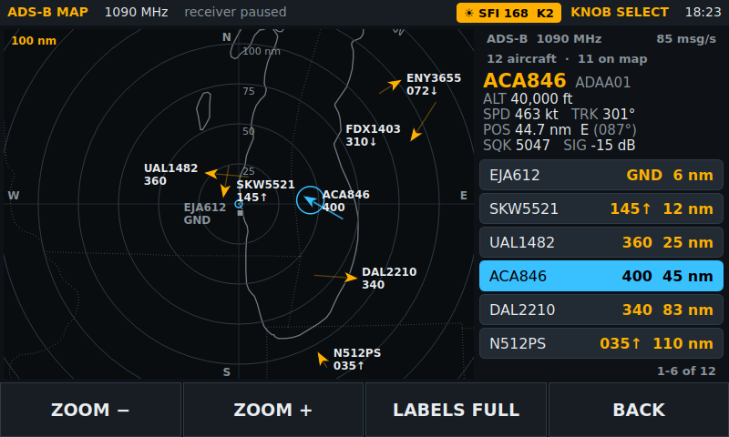

# 02 - Software setup

Target: Raspberry Pi OS **64-bit, Desktop** (Debian 13 "Trixie" based, 2025 or later
image). Bookworm also works; the package names below are the same.

## 1. Flash and first boot

1. Raspberry Pi Imager -> Raspberry Pi 4 -> Raspberry Pi OS (64-bit). In the OS
   customisation dialog set the hostname (`pisdr`), a user, Wi-Fi and **enable SSH**.
2. Connect the Hosyond display (5 cm FFC, Pi bolted to the standoffs, pogo pins touching
   pins 2/4/6), insert the card, power up. The desktop should appear on the DSI screen
   with touch working - no driver installation is needed for this display.
3. If the image is upside down for your mounting, Preferences -> Screen Configuration ->
   right-click the DSI-1 output -> Orientation -> Inverted, then Apply. Touch rotates with it.
4. Update:

```bash
sudo apt update && sudo apt full-upgrade -y && sudo reboot
```

## 2. RTL-SDR Blog V4 driver check

The V4 needs `librtlsdr` 2.0.1 or newer (osmocom) or the RTL-SDR Blog fork. Trixie ships
2.0.2, which includes V4 support. Verify instead of assuming:

```bash
sudo apt install -y rtl-sdr
# Stop the DVB kernel driver from grabbing the dongle
echo 'blacklist dvb_usb_rtl28xxu' | sudo tee /etc/modprobe.d/blacklist-rtlsdr.conf
sudo reboot
```

After the reboot, plug the V4 in and run:

```bash
rtl_test -t
```

Expected: a line containing `RTL-SDR Blog V4 Detected`, the tuner reported as `R828D`,
then sample statistics. Ctrl+C to stop.

If you see `R828D` but **no** "V4 Detected" line, or signals later appear at wrong
frequencies, the library is too old. Build the osmocom driver:

```bash
sudo apt purge -y ^librtlsdr rtl-sdr
sudo apt install -y libusb-1.0-0-dev git cmake build-essential debhelper pkg-config
cd ~ && git clone https://github.com/osmocom/rtl-sdr && cd rtl-sdr
sudo dpkg-buildpackage -b --no-sign
cd .. && sudo dpkg -i librtlsdr0_* librtlsdr-dev_* rtl-sdr_*
sudo apt-mark hold librtlsdr0 librtlsdr-dev rtl-sdr
sudo reboot
```

Then re-run `rtl_test -t`. Because `gr-osmosdr` links `librtlsdr0` dynamically, the apt
version of `gr-osmosdr` continues to work with the rebuilt library.

## 3. Install the application dependencies

```bash
sudo apt install -y gnuradio gr-osmosdr python3-numpy python3-pyqt5 python3-pyqtgraph \
                    python3-gpiozero python3-lgpio git qtwayland5 qt6-wayland libxcb-cursor0 \
                    multimon-ng
sudo apt install -y gr-rds      # optional: RDS station name / radio text on FM broadcast
```

`multimon-ng` drives the data decoders (APRS, POCSAG, FLEX, EAS, DTMF). `gr-rds` is
optional; without it the RDS setting shows "not installed" and everything else works.
The ADS-B map needs `dump1090`, which `install.sh` builds (section 5f).

`python3-pyqtgraph` may pull in PyQt6 and prefer it over PyQt5; both work. The two
`*wayland*` packages give each Qt generation its Wayland platform plugin, which the
Raspberry Pi OS desktop (labwc/Wayfire) needs. The console shows which binding was
chosen (`Qt binding: PyQt6`).

Check the pieces talk to each other:

```bash
python3 -c "from gnuradio import gr, blocks, filter, analog, audio; import osmosdr; print('gnuradio', gr.version())"
python3 -c "from PyQt5 import QtWidgets; import pyqtgraph; print('pyqtgraph', pyqtgraph.__version__)"
```

## 4. Install PiSDR

```bash
cd ~
git clone <this repository> PiSDR        # or copy the folder over with scp
cd PiSDR/software
./install.sh
```

`install.sh`:

- copies nothing; it runs the app from the repository folder so `git pull` updates it,
- writes `~/.config/autostart/pisdr.desktop` so the app starts full screen on login,
- adds the user to the `gpio`, `audio`, `plugdev` and `video` groups,
- installs `/etc/udev/rules.d/99-pisdr-backlight.rules` so the app can set the DSI screen's
  brightness (Settings → DISPLAY → Brightness / Dim after),
- creates `~/.config/pisdr/` for `settings.json` and `~/Recordings/` for audio.

To update an existing install: `cd ~/PiSDR && git pull && cd software && ./install.sh`, then
reboot (group changes need a fresh login).

Run it by hand first, from the desktop session (so it can open the screen):

```bash
cd ~/PiSDR/software
python3 -m pisdr            # real radio, full screen
python3 -m pisdr --windowed # same, in an 800x480 window (useful over VNC)
python3 -m pisdr --sim      # no hardware, synthetic spectrum
```

"From the desktop session" means a terminal opened on the touchscreen or over VNC. A plain
SSH session has no display, and Qt fails with `could not connect to display`. To launch
from SSH anyway, point it at the logged-in desktop first:

```bash
export XDG_RUNTIME_DIR=/run/user/$(id -u) WAYLAND_DISPLAY=wayland-0 DISPLAY=:0
cd ~/PiSDR/software && python3 -m pisdr
```

(The user must already be logged in to the desktop on the Pi; `ls $XDG_RUNTIME_DIR` should
list `wayland-0`. If it lists `wayland-1` instead, use that name.)

`Ctrl+Q` or **Exit PiSDR** on the Settings SYSTEM tab quits; `Ctrl+C` in the terminal,
`sudo reboot` and a normal shutdown also close it cleanly (settings saved, recording finalised).

## 5. Audio output

```bash
# list sinks
wpctl status
# make the headphone jack (or a USB dongle) the default
wpctl set-default <id>
wpctl set-volume @DEFAULT_AUDIO_SINK@ 90%
```

GNU Radio opens an ALSA device, so `wpctl` only affects it when ALSA's `default` device is
bridged to PipeWire:

```bash
sudo apt install pipewire-alsa
```

Without that bridge the app tries `default`, then `pipewire`, then `pulse`, then every card
`aplay -l` lists (USB dongle before the onboard jack) and uses the first one that opens.
Force one with `PISDR_AUDIO_DEVICE=plughw:CARD=Device,DEV=0` (the card id is the short name
in `aplay -l`). Sample rate is 48 kHz.

## 5. Settings page

Long-press **FUNC** (K3) opens Settings. Five tabs run across the top: **RADIO, AUDIO,
DISPLAY, SCAN, SYSTEM**. Tap a tab or a row to select it, tap the row again or press
**CHANGE** to toggle/activate it, and turn the knob to step its value. **UP/DOWN** move the
selection and walk across tabs; long-press **UP/DOWN** jumps a whole tab. Rows ending in
`▸` open a page; **BACK** on that page returns to Settings.

| Tab | Rows |
|---|---|
| RADIO | Filter width (per mode), Tuner AGC, RF gain, Squelch, Bias tee, PPM correction, S-meter calibration, CW pitch, Data decoder, Clear decoder text, RDS on FM broadcast |
| AUDIO | Volume, Noise reduction, Noise blanker, Notch, High-pass, Low-pass; Record now, Recordings ▸, Timer start / length / repeat, Timer (arm) |
| DISPLAY | Theme, Brightness, Dim after, Clock (LOCAL/UTC), Knob acceleration, Tap snaps to signal, HF conditions panel; Spectrum rate, Waterfall speed, Zoom, Averaging, Peak hold, Trace style, Waterfall colours, Labels |
| SCAN | Dwell per channel, Resume after, Trigger level, Memory group, ON NOW only; Priority channel, Priority check every, Lockouts (CLEAR), Scan log ▸ |
| SYSTEM | Load HF presets, Network mode (rtl_tcp) ▸, ADS-B aircraft map ▸, Exit PiSDR, Shut down Pi; an info panel with the radio backend, IP address, which optional tools are installed, the backlight device and the recordings folder |

Destructive rows (clear lockouts, shut down) ask for a second press within 3 s.

**Receiver rows.**

- **Filter width** is remembered per mode: AM 4/6/8/10 kHz, NFM 7.5/10/12.5/16 kHz,
  USB/LSB 1.8–3.0 kHz, CW 200–1200 Hz (WFM is fixed). The mode picker shows each mode's
  current width and the passband marker on the spectrum follows it.
- **PPM correction**: tune a known carrier (WWV 10 MHz, a NOAA weather station) in USB or
  CW, zoom the spectrum, and step PPM until the carrier sits on the VFO line. The V4's TCXO
  is usually within ±2.
- **S-meter calibration** shifts the dB reading: feed a known level, or simply line up a
  strong local station with S9+ on a reference receiver.
- **CW pitch** (400–1000 Hz) sets both the CW tone you hear and where the Morse decoder listens.

**Display rows.** **Clock UTC** shows `HH:MMZ` in the top bar — schedules, the record timer
and the scan log all use UTC. **Brightness** and **Dim after** only work on a DSI panel
with a backlight device (the Hosyond and official displays); on HDMI the row reads
"no panel". Any touch, key or knob movement restores full brightness. **Knob acceleration**
multiplies the tuning step ×4 / ×10 when the knob is spun fast. **Averaging** smooths the
trace and **Peak hold** draws a grey max-hold line (reset on retune or zoom).

**Spectrum and waterfall.**

- **Zoom** ×1 … ×64 narrows the view around the VFO with a proportionally bigger FFT, so
  zooming adds real resolution: ×64 shows 30 kHz at about 30 Hz per bin, enough to see
  SSB voice and separate CW signals. The view re-centres as you tune. The `− x8 +` buttons
  at the bottom-right of the waterfall change it without opening Settings.
- **◀ / ▶** (either side of the zoom buttons) seek to the next detected signal below or
  above the VFO in the current view.
- **Signal markers**: every signal more than 8 dB above the local noise floor gets a ▼
  with its level above the noise in dB (strongest 10 shown).
- **Tap snaps to signal** (`TUNE`): a tap near a marked signal tunes it properly instead
  of where your finger landed — the carrier for AM/CW, the centre for FM, the edge of the
  voice for USB/LSB (SSB only snaps at zoom ×8 or closer, where the edge can be measured).
  `TUNE+FILTER` also picks the narrowest filter that passes the signal's 99 % power
  bandwidth. `OFF` tunes exactly where you tap.
- **Frequency tags** are drawn along the top with dashed lines down to the trace, and the
  name of whatever is in the passband is shown over it. Sources, highest priority first:
  your memories, `~/.config/pisdr/tags.json` (your own tags and FM station names learned
  from RDS once the name has been steady for 5 s), and the built-in
  `software/config/tags.json` (time stations, distress and calling frequencies, NOAA, FRS/
  GMRS, MURS, marine, aviation, ISS, APRS, ADS-B …). To add your own, edit the user file:

  ```json
  {"tags": [{"hz": 146940000, "label": "Club repeater"}]}
  ```

  A hand-made tag is never overwritten by RDS. Restart PiSDR after editing the file.
- **Labels** chooses what is drawn: `BOTH`, `SIGNALS` (markers only), `TAGS` or `OFF`.
- **Trace style** `FILLED` fills under the trace with a gradient of the waterfall colours;
  `LINE` is the old plain trace (slightly cheaper on CPU if the Pi struggles).
- **Waterfall colours**: `INFERNO` (black → purple → orange → yellow), `THEME` (follows
  the UI theme), `CLASSIC` (blue → green → yellow → red) or `GRAY`.

**Theme** (DISPLAY) switches the whole UI live and is remembered:

| Theme | Use |
|---|---|
| Amber | default dark, amber VFO / cyan highlights |
| Night | red-on-black for dark rooms, preserves night vision |
| Ice | cool blue/violet dark theme |
| Daylight | light, high contrast for bright rooms |
| Inferno | purple-black panels, orange values, magenta selection; matches the INFERNO waterfall |
| Green | monochrome green phosphor; set **Waterfall colours** to `THEME` for a green waterfall too |

## 5a. Audio DSP (noise reduction / filters)

Settings → AUDIO, left column:

| Setting | What it does |
|---|---|
| Noise reduction | Spectral subtraction on demodulated audio (0 = off, 1–10) |
| Noise blanker | Blanks impulse spikes in the audio after demod (0 = off, 1–10) |
| Notch filter | Narrow audio band-reject; knob sets the notch frequency |
| Audio high-pass | Cuts rumble / hum (on by default at 250 Hz) |
| Audio low-pass | Cuts hiss above the cutoff |

CHANGE toggles on/off (or NR/NB between off and 5). The knob adjusts level or frequency
while a row is selected. Active NR / NB / notch show in the top status bar.

The filters are cheap IIR stages running in C++. NR and NB are Python blocks and are
only inserted into the audio path while enabled (you will hear a brief click as the
flowgraph restarts). If audio stutters with NR/NB on while the waterfall is showing,
lower **Spectrum rate** or turn them off; the default chain is unaffected.

## 5a-ii. CW (Morse) decoder

Select **CW** mode and a text strip appears under the frequency readout. Tune so the
station's tone sits inside the passband marker (the decoder listens at the CW pitch,
700 Hz by default, ±100 Hz; Settings → RADIO → CW pitch). Decoded characters scroll in; the estimated WPM is shown at right and
**CLEAR** empties the buffer. Unknown patterns print as `*`.

Expectations: clean machine or keyer CW at 8–40 WPM decodes well; fading, QRM or sloppy
hand-sent code produces partial copy. Decoding runs on a 1 kHz envelope produced by C++
blocks, so it has no effect on audio quality. The simulator sends a looping `CQ` so you
can test the display without a dongle.

A single dit or dah on its own (what static crashes look like to a decoder) is not printed,
so an empty channel stays nearly blank instead of filling with `E` and `T`. The price is
that a lone `E` or `T` sent as a whole word is dropped too.

## 5a-iii. Data decoders (multimon-ng)

Settings → RADIO → **Data decoder** cycles `OFF / APRS / POCSAG / FLEX / EAS / DTMF`. The
demodulated audio is resampled to 22.05 kHz and piped to `multimon-ng`; decoded lines
appear in a strip under the frequency readout (newest two lines, count at right, **CLEAR**
empties it, the last 40 are kept). The top bar shows the active decoder.

| Decoder | Tune | Mode |
|---|---|---|
| APRS (AFSK1200) | 144.390 MHz (N. America), 144.800 MHz (Europe) | NFM |
| POCSAG 512/1200/2400 | local paging frequencies (often 152–158, 929–932 MHz) | NFM |
| FLEX | 929–932 MHz paging | NFM |
| EAS (SAME headers) | NOAA weather radio 162.400–162.550 MHz | NFM |
| DTMF | any FM voice channel | NFM / AM |

Keep squelch open or just below the noise: multimon-ng only sees audio that gets past
squelch. Decoding is by ear-quality audio, so weak or over-deviated signals decode partially.
Check reception and privacy laws before decoding pager traffic where you live.

## 5a-iv. RDS on FM broadcast

With **gr-rds** installed and Settings → RADIO → **RDS** on, tuning a broadcast station in
WFM shows the station name (PS), programme type (PTY) and radio text (RT) in a strip under
the frequency readout. Strong stations decode within a few seconds; it clears when you retune.

## 5b. Memories and scanning

Saved frequencies live in `~/.config/pisdr/memories.json` (created the first time you press
SAVE on the MEMORIES page). Controls:

| Action | Control |
|---|---|
| Open memories | short press K4 (`MEM`) |
| Save / delete / recall | soft keys on the MEMORIES page |
| Filter by group | the group button top-right of MEMORIES (also used by memory scan) |
| Show only stations scheduled now | `ON NOW` button on MEMORIES |
| Set / clear priority channel | long press `TUNE` on MEMORIES (badge **P**) |
| Lock out / unlock a memory | long press `DELETE` on MEMORIES (badge **⊘**) |
| Start / stop scan | long press K4 |
| While scanning | `HOLD`, `SKIP`, `BAND`/`MEM` (scan source), `STOP` |
| Lock out the channel being scanned | long press `SKIP` |
| Settings | long press K3 (`FUNC`) |

**Groups and schedules.** A memory can carry a `group` and a UTC schedule. Saving a memory
while a group is selected puts it in that group. Edit `memories.json` (or the presets file)
to add schedules:

```json
{"name": "E11 Oblique", "vfo_hz": 8102000, "mode": "USB", "step_hz": 1000,
 "group": "NUMBERS", "utc": "03:10-03:35", "days": "Mon,Wed"}
```

`utc` is `HH:MM-HH:MM` in UTC (windows may cross midnight; they count against the day they
start); `days` is optional. Scheduled memories show **ON** while inside their window and the
detail line shows the window. Memory scan follows the selected group and, with
Settings → SCAN → **ON NOW only**, skips memories that are off schedule. Schedules need the
Pi's clock right: network time over Wi-Fi, or an RTC battery for off-grid use.

**Scan settings** (Settings → SCAN): **Dwell per channel** 80–1000 ms (how long a quiet
channel is listened to), **Resume after** 1–10 s or `STAY` (how long a held channel must be
quiet before scanning continues; `STAY` waits for SKIP/RESUME), and **Trigger level**: the
scanner holds on a channel above the higher of this and the squelch level (default −75 dB).
Band scan steps the current band by the tuning step; memory scan walks the selected group.
Turning the knob or tapping the spectrum cancels the scan.

**Priority.** Pick a priority memory (Settings → SCAN → Priority channel, or long-press TUNE
on MEMORIES). While scanning, every 2–10 s the scanner hops to it for about a third of a
second; if it is active the scanner holds there, otherwise it goes straight back. `+P` in the
top bar shows priority is armed.

**Lockouts** skip a frequency in both band and memory scan. Long-press SKIP while scanning, or
lock memories from the MEMORIES page; Settings → SCAN → Lockouts → CLEAR (press twice) removes them.

**Scan log** (Settings → SCAN → Scan log ▸) lists every hold: time (UTC when the clock is set
to UTC), frequency, mode, name, peak level and how long it lasted, newest first (300 kept in
`~/.config/pisdr/scan_log.json`). `TUNE` jumps to a hit, `LOCK` toggles its lockout, `CLEAR`
(press twice) empties the log.

**HF utility / numbers stations.** The **HF utility** band (3–18 MHz, USB) lands on
UVB-76 at 4625 kHz. Settings → SYSTEM → **Load HF presets** merges
`software/config/presets_numbers_stations.json` (UVB-76, Pip, Squeaky Wheel, other
Russian channel markers, HFGCS, Canadian Forces, USCG, RAF Volmet, plus scheduled E11/E07/V13
slots) into your memories without duplicating existing ones, and adds the group and
schedule to presets you loaded before (groups `RU MARKERS`, `MIL AIR`, `VOLMET`, `NUMBERS`,
`TIME`). Then pick a group on the MEMORIES page and memory-scan it to catch a transmission. Edit that JSON to add your own. HF needs a real
antenna (long wire or loop) — the whip will hear almost nothing — and keep RF gain around
20–30 dB to avoid overload from broadcasters.

Bands in `bands.json` may overlap: **HF utility** covers 40 m, 20 m and the WWV slots. The
radio stays in the band you picked for as long as the frequency is inside it; when you tune
or key in a frequency outside it, the narrowest band that contains the new frequency is used.
Band scan covers the band named in the top bar.

## 5c. HF conditions panel (solar / weather)

Below 30 MHz a panel appears to the right of the spectrum with the numbers that decide
whether HF is open: **SFI / SSN / A / K** tiles (K coloured green–amber–red), X-ray class,
solar wind speed and Bz, geomagnetic field and noise floor, the N0NBH **band-conditions**
table (80–40 m … 12–10 m, day and night), a 24-hour **Kp** bar strip, and the local weather
(storms are flagged red — lightning QRN). The age of the data sits top-right; it turns
amber with "offline" when the feeds can't be reached.

The **☀ SFI 92 K3** chip in the top bar always shows the latest SFI and K. Tap it to hide
the panel, or to pin it on while you're on VHF/UHF. Settings → DISPLAY → **HF conditions
panel** chooses `AUTO` (default: shown below 30 MHz), `ON` or `OFF`.

Data comes from `hamqsl.com` (hourly), NOAA SWPC (every 10 min) and Open-Meteo (every
15 min) over the Pi's Wi-Fi; no API keys. The last good values are cached in
`~/.config/pisdr/spacewx.json` so the panel is populated at boot even without a network.
Weather location defaults to IP geolocation; to fix it, add to `settings.json`:

```json
"wx_lat": 43.04, "wx_lon": -87.91, "wx_units": "imperial"
```

(`"metric"` gives °C and km/h.)

## 5d. Recording, playback and the record timer

**Record now** (Settings → AUDIO) writes a 48 kHz mono WAV to `~/Recordings/`, named
`pisdr_YYYYmmdd_HHMMSS_<Hz>_<MODE>.wav`. Recordings are taken before the volume control,
so turning the volume down doesn't make them quieter. A recording uses about 5.8 MB per
minute. PiSDR will not start one with less than 200 MB free on the card and stops a running
one at 100 MB, with a message, so a forgotten recording cannot fill the card. The title of
the Recordings page shows how much recording time is left.

**Recordings ▸** lists them newest first. `PLAY` plays the selected file through the radio's
audio output (the radio is muted meanwhile, `▶ PLAY` shows in the top bar), `STOP` ends it,
`DELETE` (press twice) removes the file. Leaving the page stops playback.

**Record timer**: set **Timer start** (UTC; the knob steps 5 min, CHANGE jumps to the next
5-minute mark from now), **Timer length** (5 min–3 h)
and **Timer repeat** (`ONCE` / `DAILY`), tune the station, then set **Timer** to arm it —
arming captures the current frequency and mode. At the start time PiSDR stops any scan or
playback, tunes the station, records for the set length and then tunes back to where you
were. `TMR HH:MMZ` in the top bar shows it is armed. Stopping the recording by hand ends that
run. A one-shot timer disarms itself afterwards. The Pi's clock must be correct (network time
or an RTC).

## 5e. Network mode (rtl_tcp)

Settings → SYSTEM → **Network mode ▸** hands the dongle to `rtl_tcp` on port 1234, so SDR++,
SDR#, GQRX or any RTL-TCP client on your network can use the radio. The page shows the
address to connect to (for example `192.168.1.137:1234`). PiSDR's own receiver, scanner,
recorder and decoders are paused meanwhile; **STOP** (or pushing the knob) shuts `rtl_tcp`
down and gives the dongle back to PiSDR. The PPM correction and bias tee setting are passed
to `rtl_tcp`. rtl_tcp has no password: only use it on a network you trust.

## 5f. ADS-B aircraft map

**BAND → ADS-B 1090** (or Settings → SYSTEM → **ADS-B aircraft map ▸**) opens a radar-style
plot of the aircraft in range. An RTL-SDR cannot be a voice receiver and a 1090 MHz Mode S
decoder at once, so the dongle is lent to `dump1090` while the map is open, the same way
network mode lends it to `rtl_tcp`: PiSDR's receiver, scanner, recorder and decoders are
paused, and **BACK** stops the decoder and brings the radio back (on 1090 MHz if you came
from the band picker, where you were if you came from Settings).



- North is up and the receiver is the small circle in the middle. Rings are distances in
  nautical miles; the range in the top-left corner is the one that reaches the top and
  bottom edges.
- Each arrow is an aircraft pointing the way it is flying, with its trail (about the last
  three minutes). Beside it: the callsign (or the 6-digit ICAO address until the callsign
  has been heard) and the altitude in hundreds of feet with `↑` / `↓` when climbing or
  descending, so `350` is 35,000 ft and `024↑` is 2,400 ft and climbing. A grey square is
  an aircraft on the ground; a grey arrow has not sent a position for 15 seconds. Aircraft
  drop off the map after a minute of silence.
- The panel on the right lists the aircraft nearest first; those heard but not yet located
  are at the end. Selecting one shows altitude and climb rate, ground speed, track, distance
  and bearing from you, squawk and signal level.

| Control | Action |
|---|---|
| `ZOOM −` / `ZOOM +` | Range 10 / 25 / 50 / 100 / 150 / 250 nm |
| `LABELS` | `FULL` callsign and altitude, `NAME` callsign only, `OFF` only the selected aircraft |
| Knob | Select the next / previous aircraft by distance; push to clear the selection |
| Tap | An aircraft or a list row selects it; empty sky clears the selection |
| `BACK` | Stop the decoder and return to the radio |

**Your location.** The map is centred on the same location as the weather: `"wx_lat"` and
`"wx_lon"` in `~/.config/pisdr/settings.json` (section 5c). Set them for correct rings,
distances and bearings. Without them the location guessed from your IP address is used and
a note at the bottom of the map says so: that can be tens of kilometres out, which moves
the centre marker and every distance by as much (the aircraft and the coastlines are still
drawn in the right place relative to each other). With no location at all the map centres
on the traffic and shows positions without distances.

**The decoder.** `install.sh` builds FlightAware's `dump1090` from source (tag `v11.1`,
a few minutes on a Pi 4) and installs the one program as `/usr/local/bin/dump1090-fa`.
It does not install a service, a web server or anything that starts at boot, and PiSDR
opens no network ports for it: the decoder writes its aircraft list to a file on the RAM
disk (`$XDG_RUNTIME_DIR`), which PiSDR reads once a second. An existing
`dump1090-mutability` or `readsb` is used instead if one is already installed. To build
it by hand:

```bash
sudo apt install -y build-essential pkg-config libncurses-dev git
pkg-config --exists librtlsdr || sudo apt install -y librtlsdr-dev   # already there after the section 2 rebuild
git clone --depth 1 --branch v11.1 https://github.com/flightaware/dump1090.git
make -C dump1090 RTLSDR=yes BLADERF=no HACKRF=no LIMESDR=no SOAPYSDR=no DUMP1090_VERSION=v11.1 dump1090
sudo install -m 755 dump1090/dump1090 /usr/local/bin/dump1090-fa
```

**Reception.** 1090 MHz is line of sight: an antenna by a window or outdoors can hear
aircraft 100 nm away or more, the same antenna in a basement hears almost nothing. The
signal is vertically polarised and a quarter wave is about 6.9 cm, so a telescopic whip or
dipole wants each element at roughly that length, stood upright. The decoder runs the
tuner at maximum gain; PiSDR's gain and AGC settings do not apply to it, the **PPM
correction** does. `dump1090` has no bias-tee switch, so if **Bias tee** is ON PiSDR runs
`rtl_biast -b 1` before starting it (`rtl_biast` is normally part of the `rtl-sdr`
package); if that tool is missing, an LNA powered through the coax stays off while the map
is open.

**The outlines** (coast, lakes, country borders, state / province lines) come from Natural
Earth's public-domain 1:50m data in `software/config/outlines.npz`. That is drawn for
country-sized views, so shorelines look angular at the 10 and 25 nm ranges, and rivers,
roads and airports are not shown. `python3 tools/build_outlines.py --scale 10m` downloads
the finer data set and rebuilds the file (2.5 MB instead of 0.4 MB).

On a PC, `python -m pisdr --sim --windowed` flies a dozen made-up aircraft around the set
location so the page can be tried without a radio.

## 6. Headless CLI tune test (no UI)

Useful on the bench to prove the backend and driver before worrying about the screen:

```bash
cd ~/PiSDR/software
python3 -m pisdr.radio.flowgraph --freq 162.400e6 --mode NFM --gain 30 --seconds 20
```

You should hear the NOAA weather broadcast (US) or substitute a local FM broadcast
station with `--freq 100.1e6 --mode WFM`.

## 7. Autostart and kiosk behaviour

`install.sh` generates `software/pisdr-launch.sh` (waits up to 10 s for the dongle, then runs
`python3 -m pisdr`, logging to `~/.config/pisdr/autostart.log`) and registers it with the
compositor that Raspberry Pi OS actually uses:

| Desktop | Where it is registered |
|---|---|
| labwc (Trixie, later Bookworm) | a line in `~/.config/labwc/autostart` |
| Wayfire (early Bookworm) | `pisdr = ...` under `[autostart]` in `~/.config/wayfire.ini` |
| X11 / LXDE | `~/.config/autostart/pisdr.desktop` |

Check which one you have with `echo $XDG_CURRENT_DESKTOP` or `ps -e | grep -E 'labwc|wayfire'`
from a terminal on the desktop. If the app does not appear after a reboot, read
`~/.config/pisdr/autostart.log` - it contains the same errors you would see in a terminal.

- The app hides the mouse cursor itself (`Qt.BlankCursor`) and runs frameless at 800x480.
- To stop it auto-starting, remove the `# pisdr-autostart` lines from
  `~/.config/labwc/autostart` (or the `pisdr =` line from `wayfire.ini`) and
  `rm ~/.config/autostart/pisdr.desktop`.
- Logs: `~/.config/pisdr/pisdr.log` (rotating, 1 MB x 3) and `autostart.log`.
- A bug in a button or page handler shows an **Internal error** message on screen and the
  radio keeps running; the traceback is in `pisdr.log`.
- Settings, memories, tags and the scan log are written to a temporary file and renamed
  into place, so pulling the power mid-save leaves the previous file intact. A file that
  cannot be read at startup is kept as `<name>.corrupt` (for example
  `memories.json.corrupt`) and the radio starts with defaults for that file only.
- `sudo systemctl poweroff`, `kill` and closing the window all go through the same
  shutdown: settings are saved, a running recording is finalised and the dongle is released.

## 7a. "SIMULATOR" shown at startup

The app falls back to the simulated backend whenever the GNU Radio backend cannot be built,
and shows the reason in the orange banner. To see the full picture:

```bash
cd ~/PiSDR/software
python3 -m pisdr --check
```

This runs `rtl_test`, imports `gnuradio` and `osmosdr`, opens the dongle, builds the
demodulators, opens the audio device and constructs the backend, printing a traceback for
the first step that fails. A final "extras" step lists the optional pieces (gr-rds,
multimon-ng, rtl_tcp, the dump1090 ADS-B decoder, screen backlight access); these never
fail the check. Typical results:

| First failed step | Fix |
|---|---|
| `rtl_test`: no RTL-SDR found | Dongle not plugged in / bad extension cable; `lsusb` must list `0bda:2838` |
| `rtl_test`: usb_claim_interface | DVB driver holds it: section 2 blacklist, then reboot |
| `rtl_test`: not reported as V4 | Old `librtlsdr`; rebuild per section 2 |
| `gnuradio` / `gr-osmosdr` import | `sudo apt install gnuradio gr-osmosdr` (Python 3 bindings are included) |
| `audio` (`Unknown error 524`) | The SSH session cannot reach the desktop's PipeWire. Run the check from a terminal on the touchscreen, or `export XDG_RUNTIME_DIR=/run/user/$(id -u)` first. Then `wpctl status` and set a default sink (section 5) |

## 8. Known issues

| Symptom | Cause / fix |
|---|---|
| `rtl_test` says "usb_claim_interface error -6" | DVB kernel module grabbed the dongle; do the blacklist step and reboot |
| Spectrum is flat, no signals, "V4 Detected" missing | Old `librtlsdr`; rebuild per section 2 |
| Audio stutters | Reduce `SAMPLE_RATE` in `pisdr/config.py` to 1.024e6, or `FFT_FPS` to 15 |
| App starts on the HDMI monitor instead of the DSI | Disconnect HDMI, or set `PISDR_SCREEN=DSI-1` in the `.desktop` `Exec` line |
| "Undervoltage detected" in `dmesg` | Power supply or cable; see doc 01 section 5 |
| Brightness row says "no access" | Re-run `install.sh` (udev rule + `video` group) and reboot |
| "Radio did not reopen" after bias tee, network mode or the ADS-B map | Something else holds the dongle (`rtl_tcp`, another SDR program). Close it, then toggle bias tee or enter/leave network mode to retry |
| "No ADS-B decoder (dump1090) found" when picking ADS-B 1090 | The decoder is not installed: re-run `install.sh` with the Pi online, or build it by hand (section 5f). The band is still tuned as an ordinary band |
| "dump1090-fa stopped: ..." on, or instead of, the ADS-B map | The decoder could not open the dongle or lost it; the text after the colon is its own last message. Usually another program holds the dongle - in particular a `dump1090` / `readsb` / `piaware` **service** from an earlier install (`systemctl status dump1090-fa readsb`; `sudo systemctl disable --now <name>`). BACK returns to the radio |
| ADS-B map stays on "Listening on 1090 MHz..." | No aircraft heard: check the antenna (section 5f), move it to a window, and remember that a quiet sky at night is normal away from airways |
| ADS-B map lists aircraft that never appear on the plot | They have not sent a position the decoder could use yet (it normally needs two position messages), or they do not send one at all (older Mode S transponders) |
| "Not enough free space to record" / "Recording stopped - storage is almost full" | Less than 200 MB (start) or 100 MB (running) free; delete recordings on the Recordings page |
| "Internal error" message | A bug, not a hardware fault. The radio keeps running; send the traceback from `~/.config/pisdr/pisdr.log` |
| Memories or settings back to defaults after a crash or power cut | The file was unreadable; the original is next to it as `*.corrupt` and can be repaired by hand |
| Data decoder switches itself back to OFF | `multimon-ng` is missing (`sudo apt install multimon-ng`); the reason is shown as a status message |
